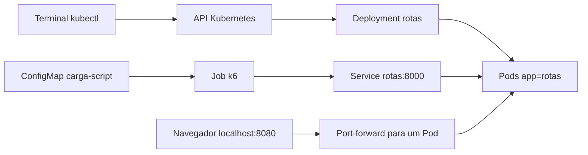

# Visão geral
Atualizado em 21/10/2026. Fonte principal: Guia_Atividade.pdf, na pasta acima. Fundamentação: Aula_Kubernetes.pdf.

Uma transportadora precisa calcular a ordem de entregas e retornar ao depósito. A aplicação fornecida explora todas as permutações de até nove destinos e escolhe o menor circuito euclidiano. Com nove entregas são 362.880 ordens. É trabalho de CPU real, com dados fictícios, sem ruas, trânsito, fila ou cache.

Cada processo admite um cálculo por vez por meio de um semáforo. Uma segunda requisição concorrente recebe HTTP 503 imediatamente. Replicar a aplicação permite cálculos simultâneos em processos distintos, mas o Service escolhe conexões sem conhecer a ocupação do calculador.

O objetivo é publicar e operar o serviço, verificar recuperação e rollback e comparar 1, 2 e 3 Pods sob a mesma demanda. Docker empacota a aplicação. Minikube fornece um cluster de um nó. kubectl administra a API. Deployment mantém réplicas, Service oferece DNS estável e EndpointSlices registram destinos. ConfigMap entrega o JavaScript ao Job k6.

A arquitetura está no namespace ops-lab e perfil ops-lab. Réplicas no mesmo nó compartilham uma falha comum. O experimento não demonstra tolerância à queda do nó nem recuperação de dados. Melhorias de produção, como múltiplos nós, TLS, HPA e observabilidade contínua, são opcionais e ficam fora da série controlada.
