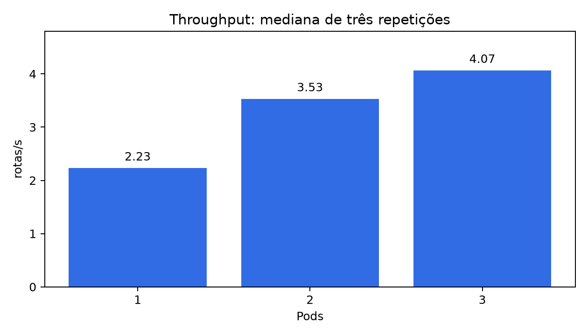
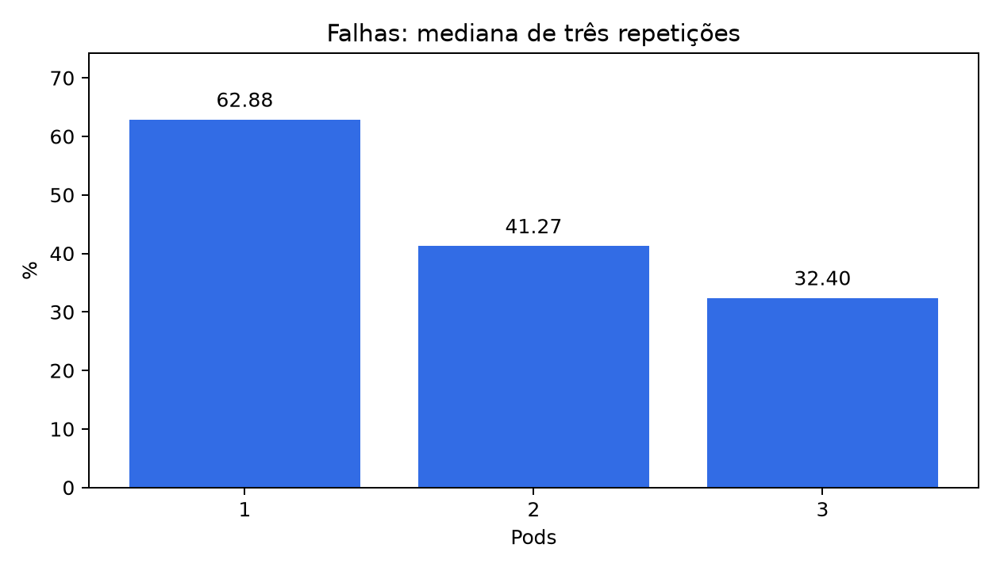
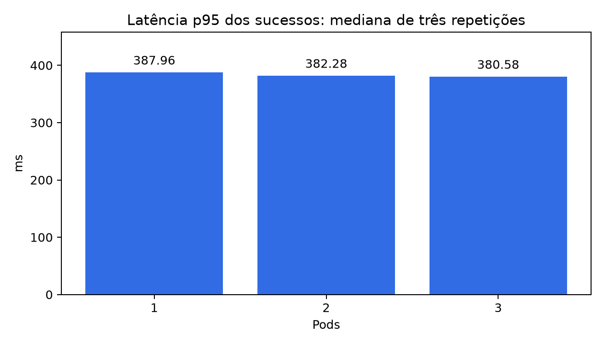
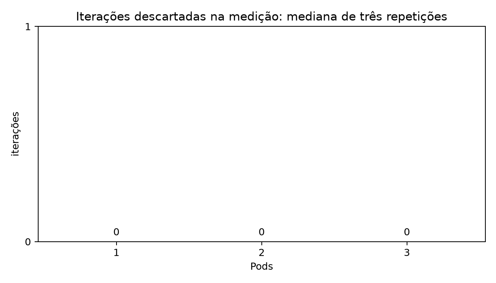

# Relatório experimental
Atualizado em 21/10/2026. Fonte principal: Guia_Atividade.pdf, na pasta acima. Fundamentação: Aula_Kubernetes.pdf.

## Cenário e método

Host Ryzen 5 7600X, Windows 11, WSL 2 e Docker Desktop. Cluster de um nó com 3 CPUs e 3072 MiB. Cada Pod solicita e limita CPU a 500m, solicita 64Mi e limita memória a 128Mi. k6 solicita 250m/128Mi e limita 500m/256Mi. Imagem rotas:1.0 e script originais preservados. Condições: PARADAS=9, medição=60 s, aquecimento=10 s e início da medição aos 20 s. Somente o número de réplicas muda. A taxa escolhida e a justificativa estão em resultados/calibracao.json quando o piloto estiver concluído.

O executor programa chegadas constantes. Falhas incluem 503, timeout e JSON inválido. p95 considera apenas sucessos. As metas são p95<800 ms, falhas<1% e zero descartes da medição. Saída 99 com resumo é resultado válido de desempenho. Falha de execução não entra como zero. A ordem alternada é A=3,1,2; B=2,3,1; C=1,2,3, sempre com convergência de réplicas e EndpointSlices antes da carga.

## Medições reais

| Execução | Pods | TAXA | Rotas | Rotas/s | Falhas (%) | p95 (ms) | Descartes |
|---|---:|---:|---:|---:|---:|---:|---:|
| piloto | 1 | 6 | 120 | 2.0 | 66.75 | 436.19 | 0 |
| 3pods-a | 3 | 6 | 239 | 3.9833333333333334 | 33.79 | 437.25 | 0 |
| 1pod-a | 1 | 6 | 121 | 2.0166666666666666 | 66.48 | 444.69 | 0 |
| 2pods-a | 2 | 6 | 200 | 3.3333333333333335 | 44.59 | 429.16 | 0 |
| 2pods-b | 2 | 6 | 212 | 3.533333333333333 | 41.27 | 381.81 | 0 |
| 3pods-b | 3 | 6 | 256 | 4.266666666666667 | 29.08 | 380.58 | 0 |
| 1pod-b | 1 | 6 | 141 | 2.35 | 60.94 | 385.78 | 0 |
| 1pod-c | 1 | 6 | 134 | 2.2333333333333334 | 62.88 | 387.96 | 0 |
| 2pods-c | 2 | 6 | 213 | 3.55 | 40.99 | 382.28 | 0 |
| 3pods-c | 3 | 6 | 244 | 4.066666666666666 | 32.4 | 378.61 | 0 |

## Cálculos

Throughput = rotas_ok / 60. Mediana = segundo valor das três repetições ordenadas de uma configuração. Não calcular mediana do conjunto misturando configurações, nem usar a taxa /s global do k6. Falhas permanecem em porcentagem e latência em milissegundos. CPU em top é mCPU e memória MiB.

Os gráficos e o PowerPoint exibem duas casas decimais; os CSVs preservam a precisão numérica usada nos cálculos e os logs mantêm a saída original do k6.

A maior mediana de throughput foi de 4.067 rotas/s com 3 Pods. O menor p95 mediano foi 380.58 ms com 3 Pods. A menor mediana de falhas foi 32.40% com 3 Pods. Descartes na série: 0. Nenhuma configuração cumpriu todas as metas nas três repetições. A decisão é não declarar capacidade suficiente para essa demanda. A próxima investigação deve examinar ocupação do calculador, fila e algoritmo, sem modificar retroativamente os parâmetros desta série.

## Custo e distribuição

1, 2 e 3 Pods reservam, respectivamente, 0,5, 1 e 1,5 CPU. Requests de memória totalizam 64, 128 e 192 MiB; limites totalizam 128, 256 e 384 MiB. Esses valores vêm da configuração e não são consumo medido. Amostras de CPU e memória de cada execução ficam em evidencias/ROTULO/recursos.txt. Deltas em distribuicao_aceitos_por_pod incluem aquecimento e não devem somar exatamente rotas_ok. Campos recém-iniciados partem de zero. UIDs e reinícios são verificados antes de aceitar o resultado.

## Diagnóstico e limites

A busca exaustiva e o limite de um cálculo simultâneo por Pod são possíveis gargalos. Só se tornam conclusões de saturação quando amostras e comportamento real os sustentam. O Service distribui conexões sem saber se o calculador está ocupado. Assim, 503 pode ocorrer com outra réplica livre. k6 e control plane compartilham o nó. Escala horizontal pode aumentar paralelismo, mas não cria CPU física nem assegura crescimento linear.

Três repetições são poucas para generalizar. Mediana de p95 não é p95 agregado. top é amostra e não prova de pico. Tarefas no Windows, temperatura, frequência da CPU, VM e rede virtual afetam os resultados. Três Pods em um nó não protegem contra falha desse nó. A conclusão vale somente para esta aplicação, parâmetros e host.

## Medianas por configuração

| Pods | Rotas/s | Falhas (%) | p95 (ms) | Descartes |
|---|---:|---:|---:|---:|
| 1 | 2.233 | 62.88 | 387.96 | 0 |
| 2 | 3.533 | 41.27 | 382.28 | 0 |
| 3 | 4.067 | 32.40 | 380.58 | 0 |

## Efeito da escala

O throughput mediano de três Pods corresponde a 1.82 vezes o de um Pod, ganho de 82.1%. O custo de CPU reservada da aplicação triplica de 0,5 para 1,5 CPU. Comparar esse fator com três ajuda a avaliar a eficiência da escala, mas não prova a causa da diferença. As recusas por ocupação, o balanceamento sem conhecimento da fila e a disputa por recursos são mecanismos compatíveis com o código e a arquitetura.

## CPU e memória observadas

Os números abaixo resumem as amostras de cada Pod durante os ciclos. Incluem períodos de aquecimento, intervalo e defasagem da coleta. CPU máxima amostrada não é pico contínuo e mediana destas amostras não equivale à utilização média de toda a janela.

| Réplicas | Mediana das leituras medianas de CPU dos Pods (mCPU) | Maior CPU amostrada (mCPU) | Faixa de memória máxima amostrada por Pod (MiB) |
|---|---:|---:|---:|
| 1 | 241 | 368 | 14–15 |
| 2 | 306.5 | 336 | 13–14 |
| 3 | 223 | 434 | 13–15 |

O gerador teve no máximo 20m de CPU e 23Mi de memória nas amostras registradas. Os nove resumos da medição mostraram zero iterações descartadas.

## Exercício de seis réplicas: resultado observado

No momento da captura, os estados foram {'Running': 6}. O contêiner Docker do nó estava limitado a 3 CPUs e 3072 MiB. Entretanto, o Node anunciava 12 CPUs e 15919916Ki de memória allocatable ao scheduler. Por isso, neste ambiente, o exemplo de Insufficient cpu do guia pode não se reproduzir: o agendamento usa o valor anunciado, enquanto os processos continuam sujeitos à quota do contêiner pai. Não alteramos requests nem forçamos Pods Pending para reproduzir artificialmente a saída ilustrativa. Após o exercício, restauramos uma réplica.
